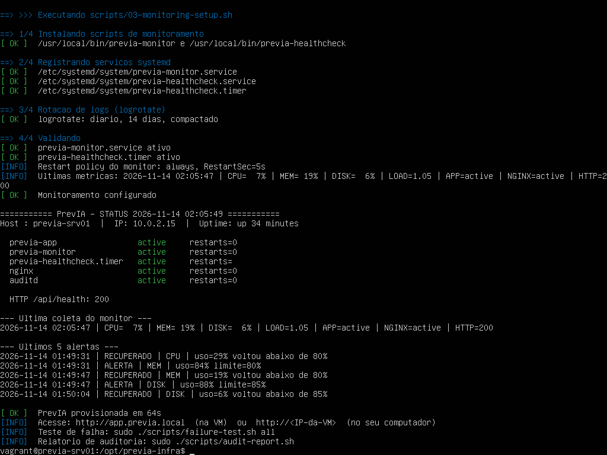
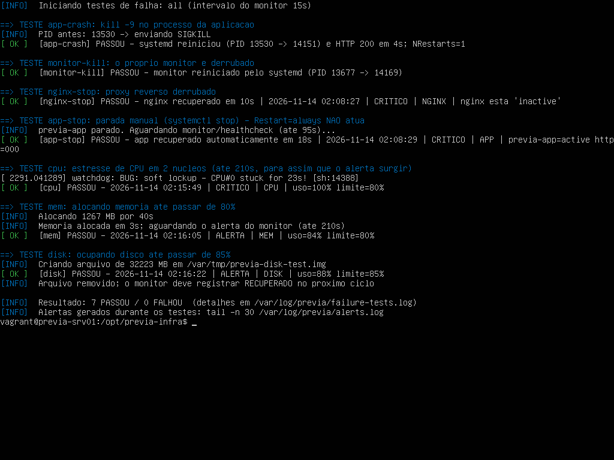
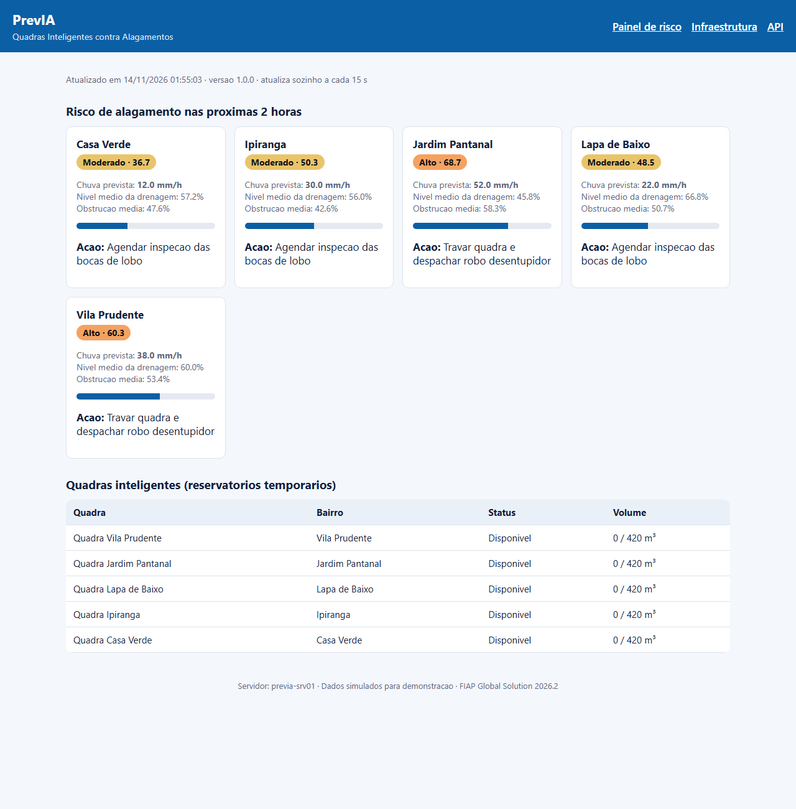
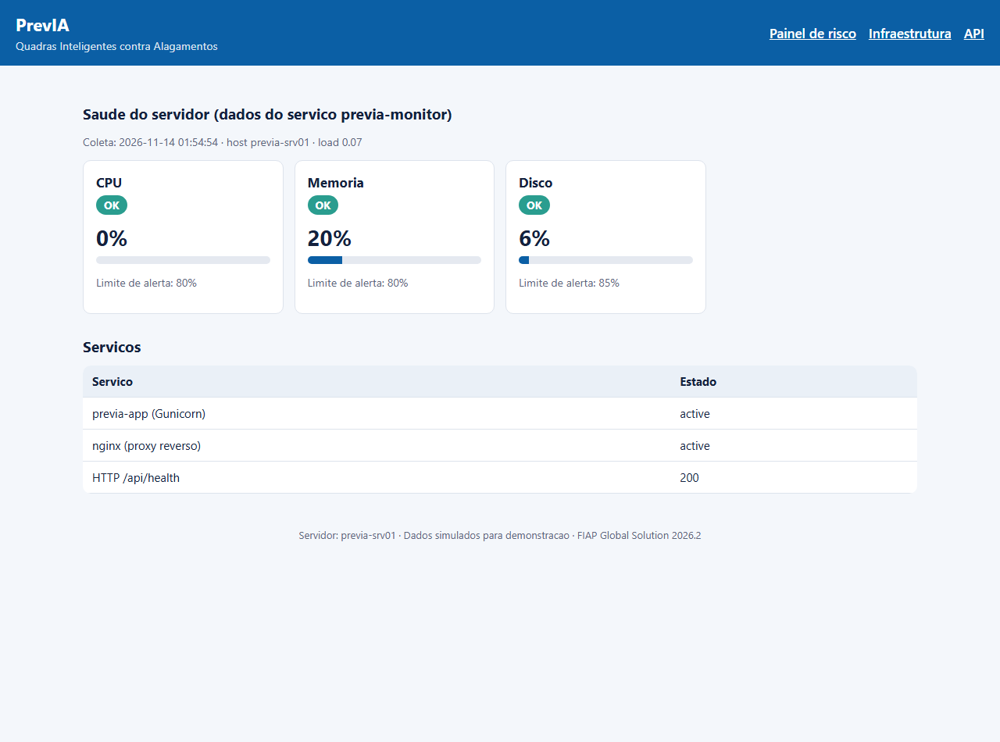
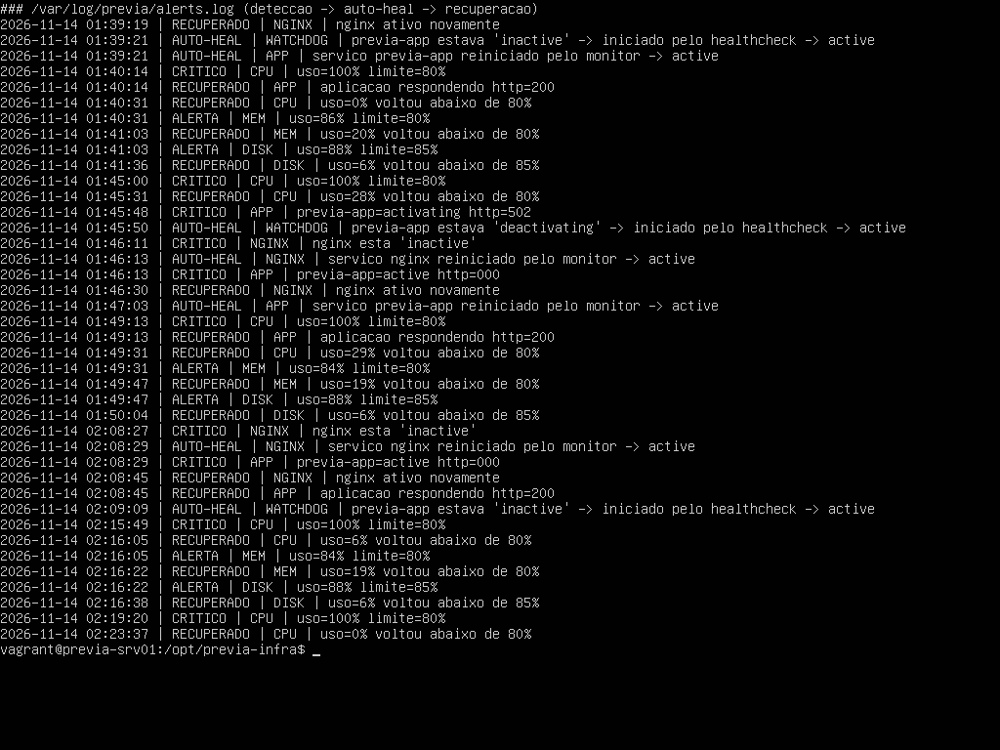
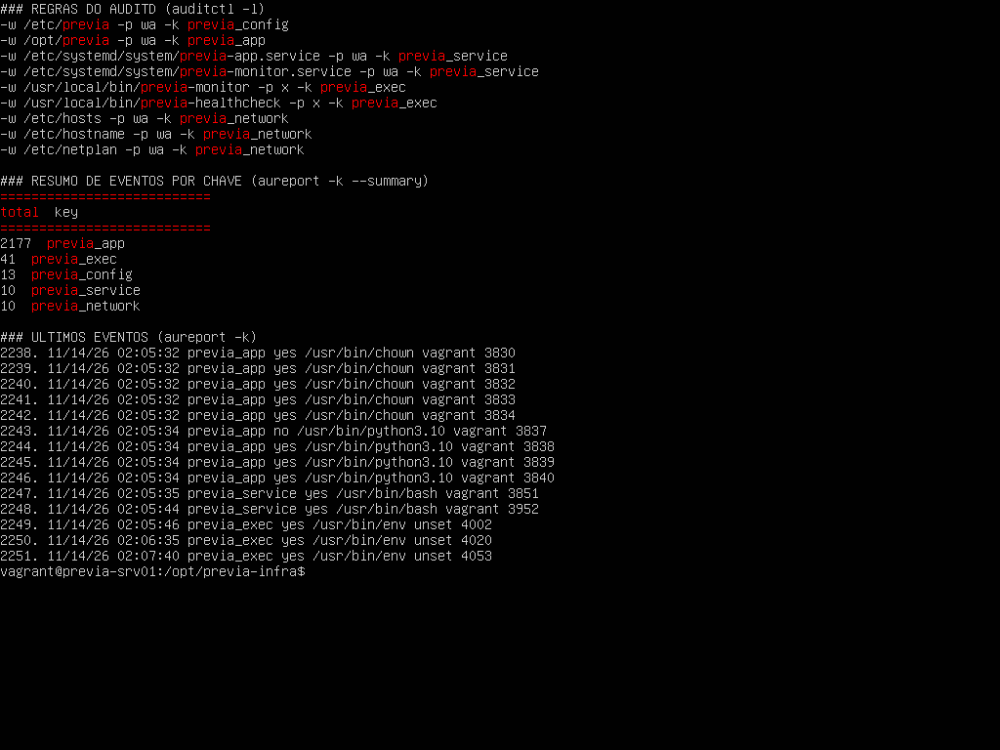

# PrevIA: Infraestrutura Linux (Operating Systems)

> **FIAP · Global Solution 2026.2 · CitizenTech · Engenharia de Software**
> Infraestrutura Linux provisionada **100% via Shell Script** para hospedar a aplicação web da PrevIA, com monitoramento como serviço tolerante a falhas, logs de auditoria e testes de falha automatizados.

🎥 **Vídeo de demonstração (até 7 min):** `https://youtu.be/wUrvskfPl2E`

## Ficha da CitizenTech

| Campo | Resposta |
|---|---|
| **Nome** | PrevIA: Quadras Inteligentes contra Alagamentos |
| **Cidade e bairro** | São Paulo (SP). Piloto em bairro com ponto de alagamento crônico |
| **Cidadão beneficiado** | Moradores e comerciantes de ruas que alagam; Defesa Civil |
| **Problema, em uma frase** | A cidade só reage ao alagamento depois que a rua já encheu, porque a drenagem fica entupida e o alerta chega tarde. |
| **Como funciona** | Sensores nas bocas de lobo e galerias alimentam uma IA que prevê onde e quando vai alagar. Com a previsão, robôs desentopem a rede antes da chuva, quadras esportivas viram reservatórios temporários e a população recebe alerta. |
| **O que esta parte faz** | Sobe e mantém o servidor Linux que hospeda o painel web/API da PrevIA, com rede, DNS, monitoramento, auditoria e recuperação automática de falhas. |
| **Indicador de impacto** | % de alagamentos previstos com antecedência; redução da lâmina d'água (cm); volume retido por quadra (m³) |
| **ODS conectados** | ODS 6 (água), ODS 11 (cidades sustentáveis), ODS 13 (ação climática) |
| **Integrantes** | Ana Clara Melo (RM 559021) · David Murillo de Oliveira Soares (RM 559078) · Lucas Serrano (RM 555170) · Yasmin Gonçalves Coelho (RM 559147) |

## Arquitetura

```
                 Navegador / App mobile
                          │ HTTP :80
┌─────────────────────────▼───────────────────────────────── VM Ubuntu 22.04 ─┐
│  ufw (só 22 e 80)          hostname previa-srv01.previa.local               │
│                            DNS: systemd-resolved + /etc/hosts (app/api/painel)│
│  ┌──────────────┐  proxy  ┌──────────────────────┐    ┌──────────────────┐  │
│  │    nginx     │────────▶│ previa-app.service   │───▶│ SQLite           │  │
│  │ (reverso)    │         │ Gunicorn + Flask     │    │ /var/lib/previa  │  │
│  └──────▲───────┘         └──────────▲───────────┘    └──────────────────┘  │
│         │ auto-heal                  │ auto-heal          ▲ metrics.json     │
│  ┌──────┴────────────────────────────┴──────────┐         │                  │
│  │ previa-monitor.service (loop a cada 15 s)    │─────────┘                  │
│  │ CPU · Memória · Disco · serviços · HTTP      │──▶ monitor.log / alerts.log│
│  └──────▲───────────────────────────────────────┘                            │
│         │ sobe se estiver parado                                             │
│  ┌──────┴───────────────────────────┐   auditd (regras previa_*)             │
│  │ previa-healthcheck.timer (1 min) │   audit.log (toda execução de script)  │
│  └──────────────────────────────────┘                                        │
└──────────────────────────────────────────────────────────────────────────────┘
```

## Estrutura do repositório

```
.
├── provision.sh                 # PONTO DE ENTRADA: provisiona tudo em sequência
├── Vagrantfile                  # cria a VM e roda o provision.sh sozinho
├── config/previa.env            # TODAS as variáveis (hostname, IP, DNS, porta, limites)
├── scripts/
│   ├── lib/common.sh            # logs padronizados + trilha de auditoria
│   ├── 01-infra-network.sh      # hostname, rede/IP, DNS, timezone, firewall, auditd
│   ├── 02-app-provision.sh      # dependências, usuário, variáveis, app, banco, systemd, nginx
│   ├── 03-monitoring-setup.sh   # monitor como serviço + watchdog + logrotate
│   ├── monitor.sh               # monitor de CPU/memória/disco/serviços (vira previa-monitor)
│   ├── healthcheck.sh           # watchdog de 2ª camada (vira previa-healthcheck)
│   ├── failure-test.sh          # testes de falha automatizados
│   ├── audit-report.sh          # relatório consolidado de auditoria
│   └── status.sh                # painel de status no terminal
├── systemd/                     # units: previa-app, previa-monitor, previa-healthcheck(.timer)
├── nginx/previa.conf            # proxy reverso
├── app/                         # aplicação web PrevIA (Flask + Gunicorn + SQLite)
├── evidencias/                  # prints, logs e relatórios gerados
└── docs/roteiro-video.md        # roteiro do vídeo de 7 minutos
```

## Como executar

### Opção A: Vagrant (recomendado, 1 comando)

Requisitos: [VirtualBox](https://www.virtualbox.org/) e [Vagrant](https://developer.hashicorp.com/vagrant/install).

```bash
git clone <URL-DESTE-REPOSITORIO> previa-infra
cd previa-infra
vagrant up          # cria a VM Ubuntu e roda ./provision.sh automaticamente
```

Acesse no seu computador: **http://localhost:8080** ou **http://192.168.56.10**

> **Windows com Docker Desktop/WSL2:** o Hyper-V fica ativo e o VirtualBox entra num modo lento (ícone de tartaruga verde; no log aparece `Snail execution mode`). Funciona, mas o boot pode estourar o tempo limite do Vagrant. Para deixar rápido, rode `bcdedit /set hypervisorlaunchtype off` como Administrador e reinicie (para voltar: `bcdedit /set hypervisorlaunchtype auto`).

### Opção B: qualquer VM Ubuntu 22.04/24.04 (VirtualBox, VMware, Hyper-V, nuvem)

```bash
sudo apt-get update && sudo apt-get install -y git
git clone <URL-DESTE-REPOSITORIO> previa-infra
cd previa-infra
sudo ./provision.sh
```

O script é **idempotente**: rodar de novo atualiza a configuração sem quebrar o ambiente.

### Comandos de operação

| Comando | O que faz |
|---|---|
| `sudo ./provision.sh` | Provisiona tudo (infra → app → monitoramento) |
| `sudo ./scripts/status.sh` | Painel rápido de status |
| `sudo ./scripts/failure-test.sh all` | Roda todos os testes de falha |
| `sudo ./scripts/failure-test.sh cpu` | Roda um teste específico (`app-crash`, `app-stop`, `nginx-stop`, `monitor-kill`, `cpu`, `mem`, `disk`) |
| `sudo ./scripts/audit-report.sh` | Gera o relatório de auditoria em `evidencias/` |
| `tail -F /var/log/previa/monitor.log` | Acompanha as métricas em tempo real |
| `tail -F /var/log/previa/alerts.log` | Acompanha os alertas em tempo real |
| `journalctl -u previa-monitor -f` | Logs do serviço de monitoramento no journald |

## Critérios de avaliação: onde cada um está

| Critério (pontos) | Onde está | Como demonstrar |
|---|---|---|
| **Provisionamento de infra: redes, DNS, IP (2)** | [scripts/01-infra-network.sh](scripts/01-infra-network.sh) | Hostname/FQDN, detecção de interface/IP/gateway, IP fixo opcional via netplan, DNS via systemd-resolved, nomes internos `app/api/painel.previa.local`, timezone, firewall ufw, validação de resolução |
| **Provisionamento da aplicação: dependências, configurações, orquestração (2)** | [scripts/02-app-provision.sh](scripts/02-app-provision.sh) | apt (python3, nginx, sqlite3), usuário de serviço sem login, diretórios/permissões, variáveis em `/etc/previa/previa.env`, chave secreta gerada, venv + pip, banco inicial, systemd + nginx, health check final |
| **Monitoramento com alertas de CPU, disco e memória (2)** | [scripts/monitor.sh](scripts/monitor.sh) | Coleta a cada 15 s; `ALERTA` ao passar do limite, `CRITICO` ≥ 95 %, `RECUPERADO` ao voltar; grava em arquivo, no syslog/journald e na página `/infra` |
| **Monitoramento como serviço tolerante a falhas (1)** | [systemd/](systemd/), [scripts/03-monitoring-setup.sh](scripts/03-monitoring-setup.sh), [scripts/healthcheck.sh](scripts/healthcheck.sh) | 3 camadas (ver abaixo) |
| **Logs de auditoria e execução (1)** | [scripts/lib/common.sh](scripts/lib/common.sh), [scripts/audit-report.sh](scripts/audit-report.sh) | `audit.log` (início/fim/resultado de cada script), `provision.log` (cada comando), `auditd` com chaves `previa_*`, relatório consolidado |
| **Funcionamento completo (2)** | [provision.sh](provision.sh), [scripts/failure-test.sh](scripts/failure-test.sh) | `vagrant up` → app no ar → testes de falha passando |

## Tolerância a falhas (3 camadas)

| Camada | Mecanismo | Cobre |
|---|---|---|
| 1 | `Restart=always` + `StartLimitIntervalSec=0` nos serviços `previa-app` e `previa-monitor` | Crash, `kill -9`, OOM: o systemd sobe de novo em 3 a 5 s, sem limite de tentativas |
| 2 | `previa-monitor` faz **auto-heal**: se o app ou o nginx caírem, ele reinicia o serviço e registra `AUTO-HEAL` | Serviço parado/inativo, proxy fora do ar |
| 3 | `previa-healthcheck.timer` roda a cada 1 min e sobe **qualquer** serviço parado, inclusive o próprio monitor | `systemctl stop` manual (que o `Restart=always` não cobre) ou o monitor travado |

O monitor também roda com `Nice=-5` e `OOMScoreAdjust=-900`, para continuar ativo mesmo com o servidor sob estresse.

## Testes de falha

`sudo ./scripts/failure-test.sh all` provoca 7 falhas reais e verifica a recuperação. Cada resultado vai para `/var/log/previa/failure-tests.log`.

| Teste | Falha provocada | Resultado esperado |
|---|---|---|
| `app-crash` | `kill -9` no Gunicorn | systemd reinicia com novo PID, HTTP 200 em ~5 s |
| `monitor-kill` | `kill -9` no monitor | systemd reinicia o monitor |
| `nginx-stop` | `systemctl stop nginx` | monitor detecta (`CRITICO NGINX`) e reinicia (`AUTO-HEAL`) |
| `app-stop` | `systemctl stop previa-app` | monitor/watchdog sobem o app de novo |
| `cpu` | 100 % de CPU em todos os núcleos | `CRITICO CPU` e depois `RECUPERADO` |
| `mem` | aloca memória até passar de `MEM_LIMIT` | `ALERTA MEM` e depois `RECUPERADO` |
| `disk` | `fallocate` até passar de `DISK_LIMIT` | `ALERTA DISK`, o arquivo é removido e depois `RECUPERADO` |

## Logs gerados

| Arquivo | Conteúdo |
|---|---|
| `/var/log/previa/provision.log` | Execução detalhada: cada passo e cada comando dos scripts |
| `/var/log/previa/audit.log` | Trilha de auditoria: usuário, UID, host, script, ação, resultado e duração |
| `/var/log/previa/monitor.log` | Histórico de métricas (CPU, memória, disco, load, serviços, HTTP) |
| `/var/log/previa/alerts.log` | Alertas `ALERTA` / `CRITICO` / `RECUPERADO` / `AUTO-HEAL` |
| `/var/log/previa/healthcheck.log` | Estado dos serviços a cada execução do watchdog |
| `/var/log/previa/failure-tests.log` | Resultado de cada teste de falha |
| `/var/log/previa/app-*.log` | Logs de acesso e de erro do Gunicorn |
| `ausearch -k previa_config` (etc.) | Eventos do kernel (auditd): mudanças em config, app, serviços, rede e execução dos scripts |
| `journalctl -t previa-monitor` | Os mesmos alertas no journald/syslog |

Todos os logs rodam pelo logrotate (diário, 14 dias, compactados).

## Evidências (execução real na VM)

Todos os prints e logs estão em [evidencias/](evidencias/README.md). Principais:

| Provisionamento automático | Teste de falha: 7 de 7 |
|---|---|
|  |  |
| **Aplicação hospedada** | **Monitoramento exibido na aplicação** |
|  |  |
| **Alertas e auto-heal** | **Auditoria (auditd)** |
|  |  |

## Configuração

Tudo fica em [config/previa.env](config/previa.env): hostname, domínio, IP fixo (opcional), servidores DNS, porta, limites de alerta e intervalo do monitor. Para usar IP fixo, preencha `STATIC_IP="192.168.56.10/24"` e `STATIC_GATEWAY`.

> ⚠️ O `EnvironmentFile` do systemd não aceita comentário na mesma linha do valor. Mantenha os comentários em linhas separadas. Esse problema apareceu nos nossos próprios testes de falha e foi corrigido.

## A aplicação hospedada

[app/](app/) é o painel web/API da PrevIA (Flask + Gunicorn + SQLite, com **dados simulados**):

| Rota | Conteúdo |
|---|---|
| `/` | Painel de risco de alagamento por bairro e status das quadras-reservatório |
| `/infra` | Saúde do servidor (CPU, memória, disco, serviços), alimentada pelo `previa-monitor` |
| `/api/health` | Health check usado pelo monitor e pelos testes |
| `/api/risco`, `/api/sensores`, `/api/quadras`, `/api/infra` | API REST em JSON |

O cálculo de risco aqui é uma regra simplificada para a demonstração. O modelo de IA completo está na entrega de Inteligência Artificial & ML.

## Uso de IA

O registro dos prompts usados está em [prompts.md](prompts.md), conforme as regras da GS.
